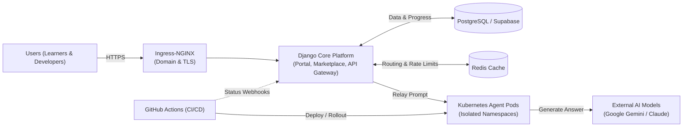

# Comprehensive Platform Documentation: ExcellStudy

---

## 1. Tech Stack Overview

ExcellStudy is an AI-powered educational marketplace and runtime platform where developers build, test, and deploy specialized AI teaching agents in isolated Kubernetes environments, and learners interact with them through personalized learning sessions.

```
┌────────────────────────────────────────────────────────────────────────┐
│                              TECH STACK                                │
├────────────────────────┬───────────────────────────────────────────────┤
│ Core Backend           │ Python 3.11+, Django 5.x (ASGI/WSGI), DRF     │
│ Asynchronous & Tasks   │ Celery, Celery Beat, Redis Broker             │
│ Web & Real-Time        │ Gunicorn (threaded), Uvicorn, SSE, Channels   │
│ Primary Relational DB  │ PostgreSQL (Supabase) + pgvector embeddings   │
│ Cache & Message Bus    │ Redis (in-cluster) for Pub/Sub & Caching      │
│ Knowledge Graph        │ Neo4j (Concept dependency mapping)            │
│ Agent Protocols        │ FastMCP 2.0+ (Model Context Protocol)         │
│ AI / LLM Models        │ Google Gemini (2.5 Flash/Pro), Anthropic      │
│ Container Orchestration│ Kubernetes (DOKS), Ingress-NGINX, Cert-Manager│
│ Container Registry     │ GitHub Container Registry (GHCR)              │
│ CI/CD Pipeline         │ GitHub Actions (Self-hosted GCP runner)       │
│ File & Media Storage   │ S3-compatible Object Storage (Supabase / S3)  │
│ Frontend Interface     │ Django Templates, Tailwind CSS, Vanilla JS    │
└────────────────────────┴───────────────────────────────────────────────┘
```

### Detailed Layer Breakdown

#### A. Backend & API Layer
* **Django 5.x**: Core application framework powering user management, agent catalog, developer portal, and administrative moderation.
* **Django REST Framework (DRF)**: Powers the JSON API endpoints for agent health, pipeline status, and context querying.
* **Gunicorn & Uvicorn**: Gunicorn manages worker processes with multithreading enabled (`--threads 4`), and ASGI handles asynchronous request dispatching.
* **WhiteNoise**: Serves and compresses production static files directly from the application layer.

#### B. Databases & Caching Layer
* **Supabase PostgreSQL**: Managed cloud relational database housing users, learner profiles, courses, modules, and agent metadata.
* **pgvector**: PostgreSQL extension enabling vector similarity search for curriculum retrieval.
* **Redis**: In-memory data store performing four distinct duties:
  1. *Routing Cache*: High-speed lookup of agent endpoint locations.
  2. *Pub/Sub Broker*: Streams real-time CI/CD deployment logs over SSE to developers.
  3. *Rate Limiting*: Sliding-window invocation limiting (60 req/min per IP).
  4. *Celery Broker*: Queue manager for background tasks.
* **Neo4j**: Graph database modeling educational concept dependencies, prerequisites, and learning pathways.

#### C. Microservices & Agent Architecture
* **FastMCP Microservices**: Model Context Protocol microservices running inside Kubernetes:
  * `learner-context-mcp`: Fetches student learning style, pace, and past performance.
  * `content-mcp`: Performs semantic retrieval over course modules.
  * `knowledge-graph-mcp`: Queries prerequisite graphs in Neo4j.
* **Isolated Agent Runtimes**: Every AI agent is packaged as an independent container running FastAPI/Uvicorn on port `8080` in its own Kubernetes namespace (`dev-<username>`).

#### D. Infrastructure & CI/CD
* **DigitalOcean Kubernetes (DOKS)**: Houses the platform workloads, ingress controllers, Redis, and developer agent pods.
* **Ingress-NGINX & Cert-Manager**: Handles external HTTP/HTTPS traffic routing and automatic SSL/TLS certificate generation via Let's Encrypt.
* **GitHub Actions (Self-Hosted Runner)**: An isolated VM with access to the Kubernetes cluster API that runs Trivy vulnerability scanning, container builds, and `kubectl` rollouts.

---

## 2. Django Apps Architecture

The Django backend is modularized into **8 specialized applications** under the `apps/` package:

```
apps/
├── core/         # Data models, authentication, middleware, input schemas
├── agents/       # Agent invocation routing, Redis caching, rate limiting
├── learner/      # Student dashboard, interactive sessions, file uploads
├── developer/    # Developer dashboard, agent registration, quota enforcement
├── pipeline/     # CI/CD dispatch, webhook handlers, SSE real-time log streaming
├── playground/   # Interactive testing sandbox for agent creators
├── marketplace/  # Public catalog and discovery directory for agents
└── blog/         # Markdown blogging system with custom admin moderation
```

---

### 1. `apps.core` (Foundation & Domain Models)
The foundation of the entire platform. Defines relational schemas, user roles, middleware, and validation rules.
* **Key Models**:
  * `Learner`: Profile linked 1-to-1 with Django `User`. Tracks age, grade, preferred learning style (`visual`, `auditory`, `kinesthetic`), pace, and JSON skill levels.
  * `Developer`: Profile for agent creators. Holds auto-generated namespace (`dev-<username>`), API keys, GitHub username, and resource quotas (max pods and RAM).
  * `Course` & `Module`: Curriculum structure with subject areas, age groups, and concept keys.
  * `AgentRegistry`: The master record of AI agents. Tracks status (`pending`, `live`, `rejected`), semver version, health status, input/output types, and internal Kubernetes service URLs.
  * `LearnerProgress`: History of completed modules, quiz scores, and the AI agent used.
* **Core Middleware**:
  * `LearnerContextMiddleware`: Injects learner profile context into active requests.
* **Input/Output Validation**:
  * Validates payloads against schemas (`text`, `image_upload`, `file_upload`, `code_editor`, etc.).

---

### 2. `apps.agents` (Agent Execution & Router)
The high-throughput execution gateway that connects learners to running AI agents in Kubernetes.
* **Key Components**:
  * `invoke_agent`: An async view acting as an HTTP relay. It enforces IP rate limits (60 req/min), validates payloads against the agent's schema, resolves the agent's internal address, and relays the prompt.
  * `router.py`: Constructs the intra-cluster DNS URL (`http://<agent-svc>.<namespace>.svc.cluster.local/invoke`) and streams HTTP requests to the target pod with timeout safeguards.
  * `registry.py`: Implements **Cache-Aside Redis caching** (`agent_registry:<slug>`). Resolves metadata in <1ms to avoid database queries on every user keystroke.
  * `_error_envelope`: Formats all runtime errors (`RATE_LIMIT_EXCEEDED`, `NOT_FOUND`, `AGENT_TIMEOUT`) into a predictable, machine-readable JSON structure.

---

### 3. `apps.learner` (Learner Portal)
Provides the educational user interface for students.
* **Key Components**:
  * **Dashboard**: Displays enrolled courses, recently used live agents, and module progress.
  * **Session Interface** (`/learner/agent/<slug>/`): Renders dynamic input controls matching the agent's expected input type (text box, image upload, audio recorder).
  * `LearnerImageUploadView`: Validates and stores learner attachments to S3/media storage before forwarding image URLs to multimodal AI models.

---

### 4. `apps.developer` (Developer Portal & Governance)
Self-service control panel where developers register, inspect, and monitor their AI agents.
* **Key Components**:
  * **Agent Creation Form**: Validates container image names, input/output contracts, and resource declarations.
  * **Quota Enforcement**: Ensures developers do not exceed allocated Kubernetes pod counts or memory limits before triggering builds.
  * **Pipeline Triggering**: Invokes the GitHub Actions workflow dispatch API when a developer submits an agent.

---

### 5. `apps.pipeline` (CI/CD & Live Log Streaming)
Automates the validation, scanning, and deployment of agent containers.
* **Key Components**:
  * **Webhook Receiver** (`/api/v1/pipeline/webhook/`): Accepts status updates from the GitHub Actions runner and updates `AgentRegistry` state (`building`, `testing`, `deploying`, `live`, `failed`).
  * **SSE Log Streamer** (`/api/v1/pipeline/events/<slug>/`): Uses Server-Sent Events backed by Redis Pub/Sub channels to stream live container build logs directly to the developer's browser without page refreshes.
  * **Celery Sweeper Tasks** (`tasks.py`): Runs scheduled cleanups (e.g. daily at midnight) to mark stuck or abandoned `pending` deployments as failed.

---

### 6. `apps.playground` (Testing Sandbox)
An isolated sandbox environment where developers can test their agents prior to public publishing.
* Allows developers to manually tweak learner context variables (age, skill level, pace) to verify how the agent adapts its pedagogy.
* Tests all approved input schemas (e.g. uploading images or testing units).

---

### 7. `apps.marketplace` (Agent Catalog & Discovery)
The public storefront where learners and educators discover verified AI teaching agents.
* Provides filtering by **subject area** (e.g., Mathematics, Biology), **grade level** (K-12, Higher Ed), **input type**, and **capabilities**.
* Renders agent cards with verified status badges and developer namespaces.

---

### 8. `apps.blog` (Educational Blog & Content Engine)
Content marketing and knowledge-sharing platform integrated into the ecosystem.
* **Markdown Authoring**: Integrated with **EasyMDE** for client-side Markdown editing.
* **Moderation Workflow**: Articles transition through `draft` -> `pending_review` -> `approved` / `rejected`.
* **Admin Review Panel** (`/admin-panel/blog/`): Dedicated review dashboard for superusers to preview, approve, or reject submissions with feedback.

---

## 3. System Workings & Block Diagram

### High-Level Architecture Diagram



---

### Step-by-Step Walkthrough of the 3 Core Workflows

#### 1. The Learner Invocation Journey
1. **Request**: The learner interacts with an agent from their browser interface. A `POST` request is sent to `/api/v1/agents/<agent-slug>/invoke/` with the payload (e.g. text question or uploaded image URL).
2. **Rate Limiting & Validation**:
   * `apps.agents` checks Redis (`ratelimit:invoke:<ip>`). If the client has sent >60 req/min, it halts immediately with HTTP `429`.
   * The payload is validated against the agent's declared `input_type` contract.
3. **Registry Resolution (Cache-Aside)**:
   * Django checks Redis for key `agent_registry:<slug>`.
   * **Cache Hit**: Returns the agent dictionary and internal URL in <1ms.
   * **Cache Miss**: Reads Postgres (`AgentRegistry`), caches the result in Redis with a 300-second TTL, and continues.
4. **Intra-Cluster Relay**:
   * `router.py` formats the internal cluster request:
     `http://dev-shafayat-hossain-quick-steps-svc.dev-shafayat-hossain.svc.cluster.local:80/invoke`
   * The agent pod receives the input, queries the FastMCP microservices for learner context and course prerequisites, calls the LLM (Google Gemini), and returns the formatted response.
5. **Persistence**:
   * The response is returned to the learner, and an entry is asynchronously saved to `LearnerProgress` in PostgreSQL.

---

#### 2. The Developer Agent Deployment Journey
1. **Submission**: A developer registers an agent at `/developer/agents/new/`, providing their container image tag on GHCR (`ghcr.io/<developer>/<agent-name>:<version>`).
2. **Quota Verification**: `apps.developer` ensures the developer has not exceeded their pod quota (e.g., maximum 3 pods) or memory allocations.
3. **Dispatch**: The platform triggers a GitHub Actions `workflow_dispatch` call to `.github/workflows/agent-pipeline.yml`.
4. **Automated Pipeline**:
   * The self-hosted GCP runner executes the workflow.
   * **Security Scan**: Runs a Trivy vulnerability scan against the container image.
   * **Namespace & Secret Setup**: Generates the developer's Kubernetes namespace (`dev-<username>`) and applies container pull secrets.
   * **Deployment Rollout**: Deploys the pod and ClusterIP service into the isolated namespace with strict CPU/memory limits (50m CPU, 64Mi request).
5. **Live Feedback**:
   * As each step completes, the runner posts to Django's webhook endpoint (`/api/v1/pipeline/webhook/`).
   * Django publishes events to the Redis channel `pipeline_events:<slug>`.
   * The developer's browser receives the log output live via Server-Sent Events (SSE).
6. **Publication**: Once verified, the agent's status updates to `live` in Supabase, the Redis cache key is invalidated, and the agent becomes instantly discoverable on the Marketplace.

---

#### 3. MCP Context Augmentation Journey
1. **Agent Autonomy**: When an agent pod is invoked, it does not just act as a raw LLM proxy.
2. **Enrichment Calls**:
   * The agent connects over HTTP/SSE to the **FastMCP microservices** running in the `platform` namespace.
   * It queries `learner-context-mcp` to know if the student prefers visual analogies or concise summaries.
   * It queries `content-mcp` to pull verified textbook definitions from Supabase via `pgvector`.
3. **Synthesis**: The agent feeds these verified context blocks into its system prompt before generating the final answer, ensuring the student receives tailored, curriculum-accurate assistance.
